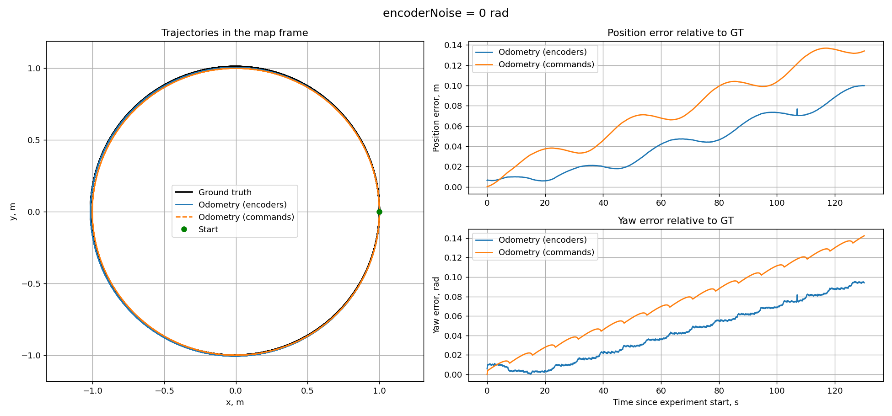
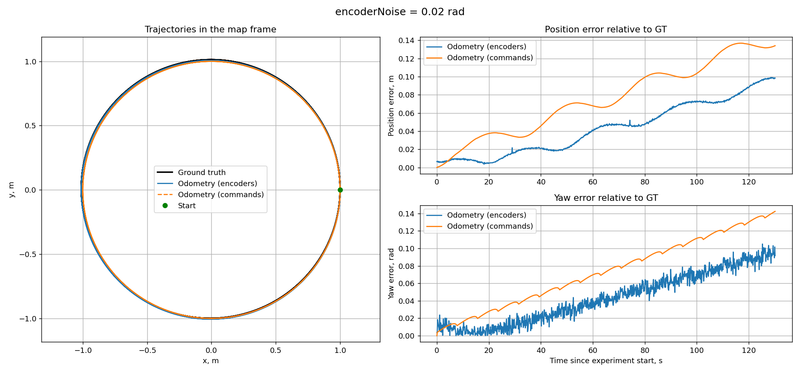
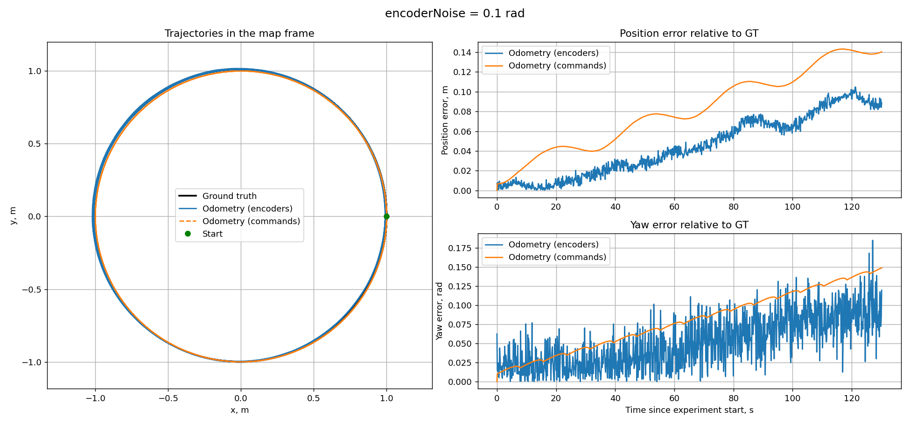

# Практическая работа 3. Одометрия и системы координат

ROS 2 пакет `practice_03_odometry`: TurtleBot3 Burger движется по окружности в Webots на пустой площадке 6 × 6 м со стенами. Сравниваются три оценки позы в системе `map`: ground truth (супервизор), одометрия по энкодерам (`diffdrive_controller`) и одометрия по командам `/cmd_vel` (считается узлом записи).


## Параметры эксперимента

- Команды: `linear.x = 0.2` м/с, `angular.z = 0.2` рад/с, 10 Гц. Радиус окружности ≈ 1 м, период ≈ 31.4 с.
- Длительность: `duration = 130` с времени симуляции (≈ 4 круга). Стены на расстоянии 3 м, столкновений нет.
- Контроллер: `wheel_separation_multiplier = 1.1` (как в примере, не менялся), одинаков для всех запусков.
- Запись начинается, когда доступны оба трансформа и пришла команда. Позы GT и энкодеров берутся из tf2 на общий момент времени.

## Сборка

В контейнере (на Mac сначала запустите `local_simulation_server.py`):

```bash
cd ~/practices_ws
colcon build --symlink-install --packages-select practice_03_odometry
source install/setup.zsh
```

Нужен `matplotlib` (`python3 -c "import matplotlib"`).

## Запуск

```bash
ros2 launch practice_03_odometry odometry_experiment.launch.py world:=world_noise_0.wbt
ros2 launch practice_03_odometry odometry_experiment.launch.py world:=world_noise_0_02.wbt
ros2 launch practice_03_odometry odometry_experiment.launch.py world:=world_noise_0_1.wbt
```

Файлы появятся в `practices/practice-03/results/`: `noise_0.png`, `noise_0_02.png`, `noise_0_1.png` и одноимённые `.csv`. Уровень шума берётся из сцены. Другие аргументы: `duration`, `linear_x`, `angular_z`, `wheel_separation_multiplier`, `mode`, `results_dir`.

## Результаты

### encoderNoise = 0


### encoderNoise = 0.02 рад


### encoderNoise = 0.1 рад


Ошибки относительно GT за 130 с:

| encoderNoise, рад | Позиция, энкодеры: средняя / конечная, м | Позиция, команды: средняя / конечная, м | Yaw, энкодеры: средняя / максимум / конечная, рад | Yaw, команды: средняя / конечная, рад |
| --- | --- | --- | --- | --- |
| 0 | 0.043 / 0.100 | 0.076 / 0.134 | 0.043 / 0.095 / 0.094 | 0.074 / 0.142 |
| 0.02 | 0.043 / 0.098 | 0.076 / 0.134 | 0.043 / 0.105 / 0.092 | 0.074 / 0.142 |
| 0.1 | 0.043 / 0.094 | 0.076 / 0.134 | 0.049 / 0.159 / 0.081 | 0.074 / 0.142 |

## Анализ

**Общая картина.** Во всех запусках робот проходит окружность радиусом около 1 м (радиус GT 1.006 м), а обе оценки остаются близкими к GT: ошибка положения за 130 с не превышает 0.14 м. Ошибки обеих оценок растут со временем почти линейно: одометрия интегрирует движение без внешней коррекции, и небольшая погрешность накапливается.

**Влияние шума энкодеров.** Рост `encoderNoise` почти не меняет ошибку положения энкодерной одометрии (средняя 0.043 м во всех запусках, конечная 0.100, 0.098 и 0.094 м), но заметно меняет ошибку угла: кривая становится так сказать шумной. Размах резких скачков ошибки yaw растёт с шумом: при 0 она гладкая, при 0.02 колеблется на сотые доли радиана, при 0.1 максимум достигает 0.159 рад. Положение при этом шум почти не накапливает, потому что одометрия считает по прибавлению углов колёс. Шум добавляется к каждому измерению независимо, а не к прибавлению. Накапливается в основном систематическая ошибка модели и она одинакова при любом шуме.

**Две оценки одометрии.** Одометрия по командам не зависит от шума: её ошибка идентична во всех трёх запусках (конечная 0.134 м и 0.142 рад), потому что она строится только по `/cmd_vel` и предполагается идеальное выполнение команд. Она гладкая, но хуже энкодерной по итоговой ошибке: энкодеры видят, как колёса реально вращаются, а команда не учитывает проскальзывание, динамику разгона и параметры контроллера (`wheel_separation_multiplier = 1.1`). Энкодерная оценка лучше (в конце 0.094–0.100 м против 0.134 м; yaw 0.081–0.094 рад против 0.142 рад), но при большом шуме её ошибка угла становится менее предсказуемой, чем у оценки по командам.

**Расхождение без шума.** Даже при `encoderNoise 0` энкодерная одометрия не совпадает с GT (конечная ошибка 0.100 м): влияют контакт колёс с поверхностью, проскальзывание, квантование показаний (`resolution 0.00628`).
